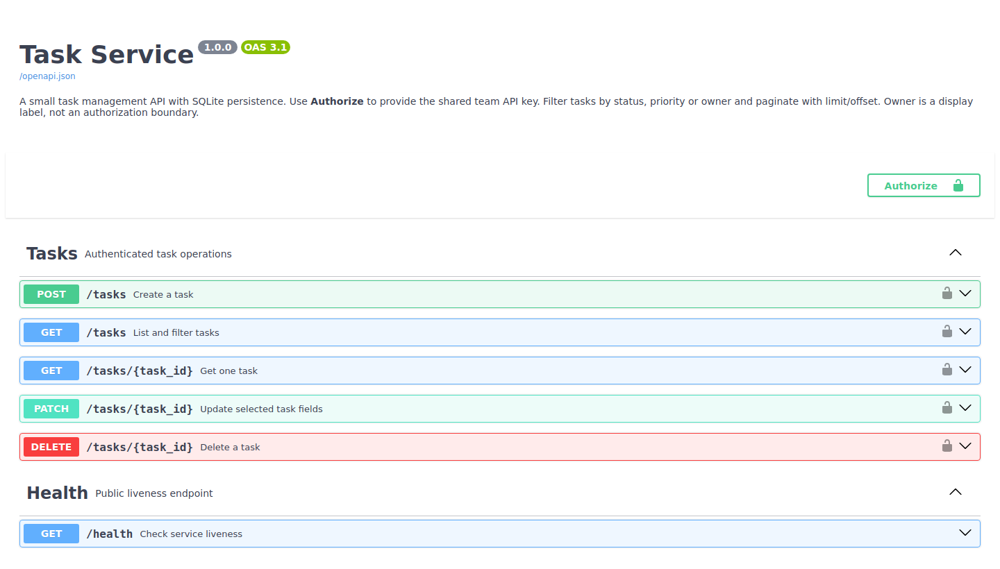
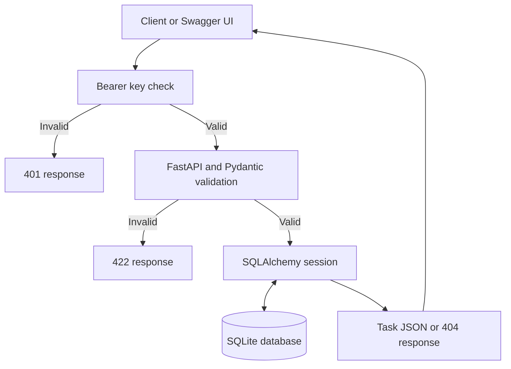

# Task Service

A small, authenticated REST API for managing tasks, owners and progress.

**Python 3.12 · FastAPI · Pydantic v2 · SQLAlchemy · SQLite · pytest**

Create and update tasks, filter a team's workload, and keep records between restarts. Explore every endpoint through Swagger UI. No frontend is required.

[API examples](docs/API_EXAMPLES.md) · [Architecture & build guide](docs/ARCHITECTURE.md) · [Security decisions](docs/SECURITY.md)



The screenshot shows the actual local `/docs` page. [View the OpenAPI contract](docs/openapi.json).

## API at a glance

| Method | Endpoint | Result |
| --- | --- | --- |
| `POST` | `/tasks` | Create a task · 201 |
| `GET` | `/tasks` | Filter and paginate tasks · 200 |
| `GET` | `/tasks/{id}` | Read one task · 200 |
| `PATCH` | `/tasks/{id}` | Update selected fields · 200 |
| `DELETE` | `/tasks/{id}` | Delete a task · 204 |
| `GET` | `/health` | Public liveness check · 200 |

All `/tasks` endpoints require `Authorization: Bearer <key>`. Missing tasks return 404; invalid inputs return 422; missing or invalid keys return 401.

## Run locally

```bash
git clone https://github.com/Marr-star/fastapi-task-service.git
cd fastapi-task-service
python -m venv .venv
```

Activate your environment:

```bash
# macOS / Linux
source .venv/bin/activate

# Windows PowerShell
.venv\Scripts\Activate.ps1
```

Install dependencies and generate a secret:

```bash
python -m pip install -r requirements-dev.txt
python -c "import secrets; print(secrets.token_urlsafe(32))"
```

Copy `.env.example` to `.env` and paste the generated value after `TASK_API_KEY=`. Keep it private. Then start the API:

```bash
uvicorn app.main:create_app --factory --reload
```

Open **[Swagger UI](http://127.0.0.1:8000/docs)**. Click **Authorize** and paste only your API key. Create a task, list it, update its status, and delete it.

## Task schema

| Field | Type | Rules |
| --- | --- | --- |
| `id` | Integer | Server-generated positive ID; not reused after deletion in new SQLite databases |
| `title` | String | Required, 1–200 characters after trimming |
| `description` | String or null | Up to 5,000 characters |
| `owner` | String or null | Optional name label, 1–100 characters |
| `status` | Enum | `todo`, `in_progress`, `done`; defaults to `todo` |
| `priority` | Enum | `low`, `medium`, `high`; defaults to `medium` |
| `due_date` | Date or null | Calendar date in `YYYY-MM-DD` format |
| `created_at` | Timestamp | Server-generated UTC creation time |

Unknown input fields are rejected. PATCH updates only supplied fields; nullable fields can be cleared with null. Historical due dates are allowed for overdue tasks.

## Example requests

For Bash, load the same secret into your shell without pasting it into command history:

```bash
read -rsp 'API key: ' TASK_API_KEY; echo
export TASK_API_KEY

curl http://127.0.0.1:8000/tasks \
  -H "Authorization: Bearer $TASK_API_KEY" \
  -H 'Content-Type: application/json' \
  -d '{"title":"Review supplier invoice","owner":"Mariam","priority":"high"}'

curl 'http://127.0.0.1:8000/tasks?status=todo&limit=10&offset=0' \
  -H "Authorization: Bearer $TASK_API_KEY"
```

Lists return `items`, `total`, `limit` and `offset`. Filters for status, priority and exact owner combine with AND. Ordering is by ID ascending. Default page size is 20, maximum 100. See [complete CRUD and error examples](docs/API_EXAMPLES.md).

## Request flow



## Tests

```bash
python -m pytest -q
```

**75 tests pass locally.** The automated suite covers task CRUD, invalid and missing values, every protected route, missing IDs, partial updates, status/priority/owner filters, pagination, CORS, OpenAPI security metadata, environment configuration and persistence across app restarts. Tests use temporary databases and never touch your development data.

GitHub Actions runs the tests on Python 3.12 and builds the Docker image and runs an HTTP smoke test, including authentication, CRUD and persistence across container replacement. Local verification results are recorded in [docs/VERIFICATION.md](docs/VERIFICATION.md).

## Docker

After building, run `python scripts/container_smoke.py fastapi-task-service` to verify the container and volume persistence.

```bash
docker build -t fastapi-task-service .
docker volume create task-service-data
docker run --rm -p 127.0.0.1:8000:8000 \
  --env-file .env \
  -e TASK_DATABASE_URL=sqlite:////data/tasks.db \
  -v task-service-data:/data \
  fastapi-task-service
```

The process runs as a non-root user. The named volume keeps SQLite data when the container is replaced. The explicit database override ensures a local `.env` URL does not redirect storage outside the volume.

Existing development databases created before the non-reusing ID change need a table migration; `create_all()` does not alter existing tables. For disposable demo data, recreate the database instead.

## Configuration

| Environment variable | Default | Purpose |
| --- | --- | --- |
| `TASK_API_KEY` | Required | Random shared bearer key, at least 32 characters |
| `TASK_DATABASE_URL` | `sqlite:///./tasks.db` | SQLAlchemy connection URL |
| `TASK_CORS_ORIGINS` | `[]` | JSON list of exact permitted browser origins |
| `TASK_DOCS_ENABLED` | `true` | Enable `/docs`, `/redoc` and `/openapi.json` |

For a browser client, set an exact origin such as `TASK_CORS_ORIGINS=["http://localhost:3000"]`. Environment variables override `.env` values. No wildcard origins or working default credentials are shipped.

## Scope and production trade-offs

This is a single-team demonstration. The shared API key authenticates access to the service, not individual users. All key holders can access all tasks; `owner` is a display label. There is no registration, user-level authorization, rate limiting, audit trail or optimistic locking.

Before public production use: add managed user authentication and task-level authorization, HTTPS and ingress limits, secret rotation, a production database, migrations, backups and operational monitoring. SQLite and startup table creation are intended for local development. See [security decisions and production changes](docs/SECURITY.md).

## Project layout

```text
app/           Configuration, models, schemas, database, security and routes
tests/         Isolated API, persistence and security tests
docs/          API examples, architecture, verification and portfolio proof
scripts/       Container smoke test
Dockerfile     Non-root container with persistent data path
.env.example   Documented configuration without credentials
```

HTTP routes live in `app/routes.py`; task queries and persistence live in `app/task_service.py`. Shared Pydantic field validation lives in `app/schemas.py`. The service raises a task-not-found exception, and the app maps it to the documented HTTP 404 response.

The [incremental build guide](docs/ARCHITECTURE.md) explains each milestone, its files, commands and acceptance criteria.

## References

[FastAPI testing](https://fastapi.tiangolo.com/tutorial/testing/) · [SQLAlchemy SQLite](https://docs.sqlalchemy.org/en/20/dialects/sqlite.html) · [Pydantic settings](https://docs.pydantic.dev/latest/concepts/pydantic_settings/)

## License

[MIT](LICENSE)
