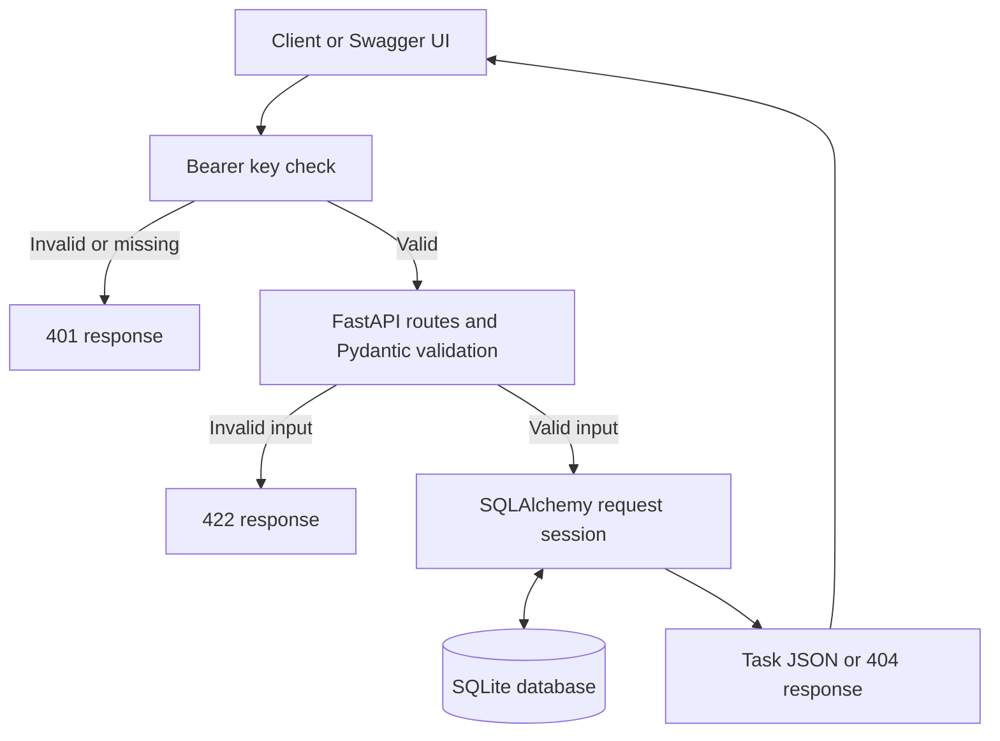

# Architecture and implementation milestones

A synchronous REST service for one trusted team. Requests pass through bearer-key authentication and Pydantic validation, then a short-lived SQLAlchemy session reads or writes SQLite. This project has no frontend and no per-user login system.

## Milestone 1: configuration and persistence

Read `app/config.py`, `app/models.py` and `app/database.py`. Configuration comes from environment variables or a local `.env`; SQLAlchemy owns the Task table and creates it on startup. Each request receives its own session, with rollback on exceptions and guaranteed closure.

Run: `python -m pytest -q tests/test_tasks.py -k restart`.

Accept when a task remains available after the application closes and reopens the same file database.

## Milestone 2: task contracts and CRUD

Read `app/schemas.py` and `app/routes.py`. The create schema requires a nonblank title. The response schema returns the database ID and UTC creation time. PATCH applies only supplied fields. Optional values can be explicitly cleared; title, status and priority cannot be null. Historical due dates are allowed for overdue work.

Run: `python -m pytest -q tests/test_tasks.py`.

Accept when create, read, update and delete return 201, 200, 200 and 204; missing IDs return 404; invalid inputs return 422 without changing stored records.

## Milestone 3: listing and ownership labels

Listings use `limit` (1–100) and `offset` (0 or greater), ordered by task ID ascending. `total` counts matching records before pagination. Status, priority and exact owner filters combine with AND. Owner is a name label, not a user record or security boundary. All key holders can access all tasks.

Run: `python -m pytest -q tests/test_tasks.py -k 'filter or pagination or empty'`.

Accept when filtering returns the correct match count and successive pages have predictable ordering.

## Milestone 4: authentication and browser boundaries

Read `app/security.py`. The shared key is supplied through `Authorization: Bearer ...` and compared in constant time. No working default key is committed. CORS allows only configured exact origins. CORS is a browser policy, not an authentication mechanism.

Run: `python -m pytest -q tests/test_security.py`.

Accept when all task routes reject missing or wrong credentials with 401, configured browser origins work, other origins receive no cross-origin permission, and docs can be disabled.

## Milestone 5: run, document and package

Read `README.md`, `docs/API_EXAMPLES.md` and `Dockerfile`. Run the complete suite with `python -m pytest -q`. Open `/docs`, authorize with your locally generated key and exercise the endpoints. Build the container with `docker build -t fastapi-task-service .`.

Before public production use, follow the specific changes in `docs/SECURITY.md`.
